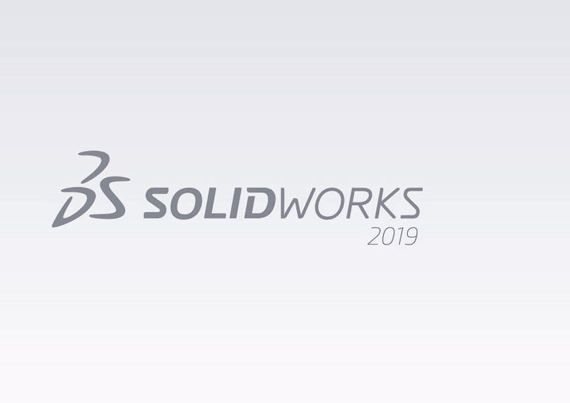
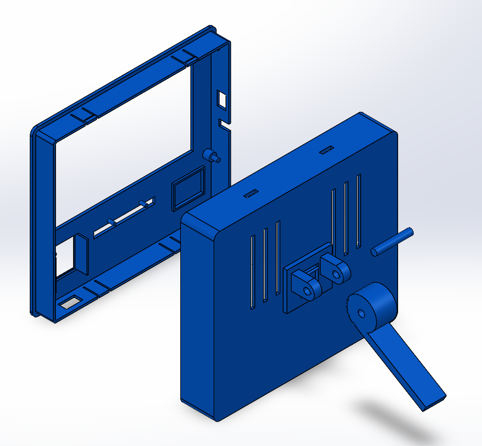
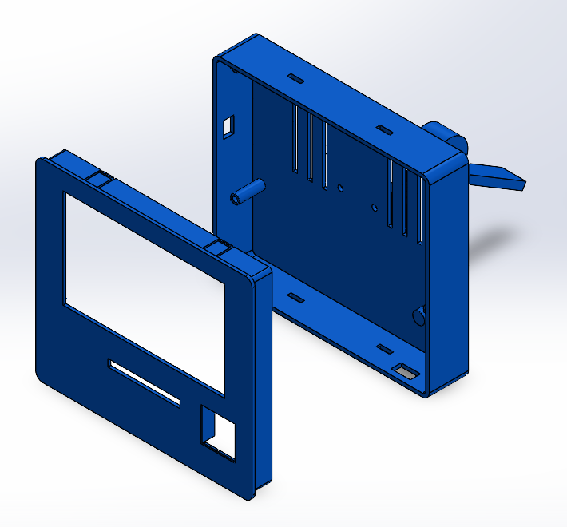
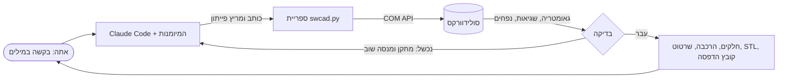

<div dir="rtl">

# קלוד × סולידוורקס

### מתארים את החלק. קלוד בונה אותו בסולידוורקס, מודד אותו ומוכיח שהוא עובד.

[](LICENSE)


[English](README.md) · [מדריך למתחילים](docs/he/getting-started.md) · [איך זה עובד](docs/how-it-works.md) · [יומן עדכונים](docs/he/changelog/README.md) · [פרויקט לדוגמה](examples/desk-agent/README.md)

<p align="center">
  <a href="assets/demo/demo.mp4"></a>
  <br><sub>קלוד בונה עמדת טלפון מתקפלת (3 חלקים + הרכבה) מתוך לשונית Claude בסולידוורקס, ואז משנה אותה במקום (זמני חשיבה קוצצו, מואץ). <a href="assets/demo/demo.mp4">לסרטון המלא</a></sub>
</p>

<p align="center">
  <a href="https://www.linkedin.com/in/yanir-hazan"></a>
  <a href="https://www.linkedin.com/in/yanir-hazan"></a>
</p>

זו **מיומנות (skill) ל-[Claude Code](https://claude.com/claude-code)** שהופכת את קלוד למהנדס סולידוורקס על המחשב שלך. אומרים במילים מה צריך, בעברית או באנגלית. קלוד כותב ומריץ את הקוד, בונה חלקים והרכבות פרמטריים אמיתיים, **בודק כל מידה וכל התאמה במספרים, ורק אז אומר שסיים.** בלי להעתיק שגיאות הלוך וחזור.

## למה מהנדסים משתמשים בזה

- **שום דבר לא "גמור" עד שנמדד.** מידות, נפח, מסה, התנגשויות, ושמירה, סגירה ופתיחה מחדש בלי אף שגיאה. שלב שלא מראה מספרים לא נגמר.
- **מודלים שאדם יכול להמשיך לעבוד עליהם.** כל מידה היא משתנה עם שם ב-*Tools ← Equations*. משנים מספר אחד וכל ההרכבה זזה. עורכים ביד, וקלוד קולט את השינוי במקום לדרוס אותו.
- **קלוד בתוך סולידוורקס.** לשונית צ'אט בחלונית המשימות: בוחרים פאה או רכיב, כותבים מה רוצים ורואים את זה קורה. בלי תוסף, בלי C#, בלי הרשאות מנהל.
- **בנוי להרכבות גדולות ואמיתיות.** נבדק על הרכבות של יותר מ-2,000 רכיבים בסולידוורקס 2019: שינוי תכנון כולל בדיקה מלאה בדקות, לא בשעות. קריאות לסולידוורקס מהירות עד פי 100 מסקריפט רגיל.
- **מהרעיון ועד רצפת הייצור.** שרטוטי ייצור עם BOM ובלונים, קבצי PDF ו-DXF, קבצי STL ופרויקטים חתוכים בבמבו סטודיו.

## מה זה יודע לעשות

- **חלקים פרמטריים:** כל מידה קשורה למשתנה עם שם וניתנת לעריכה ביד. חורי Hole Wizard, פטרנים, מירור וחומרי סולידוורקס.
- **אימות:** מידות ונפח מול חישוב ידני, בדיקת עריכה, פתיחה מחדש בלי שגיאות, ודוח סקירה בעמוד אחד.
- **הרכבות:** פריסה שמונעת מחלק שלד, בדיקת התנגשויות מול רשימת חפיפות מתוכננות, וחלקים זזים שנבדקים בכל מצב.
- **תכנון עמיד לשינויים:** ערכי הלקוח במקום אחד. עדכון במקום תוך שניות, בלי לבנות קבצים מחדש.
- **בדיקות הנדסיות:** מאמץ בתפסנים, מומנט נעילה, יציבות נגד נפילה, שרשרת סבולות.
- **שרטוטים:** מבטים בקנה מידה תקני, מידות המודל, חתכים, טולרנסים, BOM, כותרת ISO או של החברה.
- **הדפסת תלת-ממד:** כיוון הדפסה, בדיקת תמיכות, ופרויקט חתוך עם זמן וחומר לכל משטח.

## נבנה איתו: המכשיר השולחני

<p align="center">
  
</p>

מסך מגע, חיישן נוכחות, פס לדים ורמקול, שתוכננו מהסקיצה הראשונה ועד קבצי ההדפסה. חלקי ניסיון, תפסנים נסתרים, רגל מתכווננת שנבדקה ב-6 זוויות, שרטוט ייצור, ורשימה כנה של מה שהשתבש. [לפרויקט המלא ←](examples/desk-agent/README.md)

<p align="center">
  
  
</p>

## איך זה עובד

</div>



<div dir="rtl">

ה-API של סולידוורקס ענק ומלא מלכודות. המיומנות אורזת כל מלכודת ששברה בנייה אמיתית, יחד עם הפתרון, ספרייה שמטפלת בהן, ושיטת עבודה: לשאול קודם על מידות חסרות, להדפיס חלקי ניסיון לפני החלק הגדול, ולבדוק הכל.

## התחלה מהירה (5 דקות, בלי קוד)

**צריך:** מחשב Windows עם סולידוורקס (2019 עד 2025, גם גרסת הסטודנט) וחשבון Claude. כל השאר מותקן לבד.

1. לוחצים **מקש Windows + R**, מדביקים את השורה הזאת ולוחצים **Enter**:

</div>

```
powershell -ExecutionPolicy Bypass -NoExit -c "irm https://raw.githubusercontent.com/YanirBarHazan/Claude-solidworks-pro/main/install.ps1 | iex"
```

<div dir="rtl">

   *או:* בעמוד הזה **Code ← Download ZIP**, מחלצים, ולוחצים פעמיים על **`install.cmd`**.

2. מחכים ל-**Done**. ההתקנה מתקינה פייתון ו-Claude Code אם חסרים, את המיומנות ואת לשונית Claude.
3. פותחים את סולידוורקס. הלשונית **Claude** מופיעה בחלונית המשימות מימין. בפעם הראשונה בלבד לוחצים **התחבר ל-Claude**.
4. כותבים מה צריך, למשל:
   > *תתכנן לי תושבת לקיר לצינור של 40 מ"מ, שני ברגי M5, להדפסה ב-PLA בלי תמיכות.*

   קלוד שואל קודם כמה שאלות פתיחה קצרות: כמה לבדוק, האם להוציא דוח סקירה, ומה הוא הבין מהתכנון. ואז הוא בונה.

אפשר לעבוד גם מ-Claude Code מחוץ לסולידוורקס. המיומנות נמצאת ב-`%USERPROFILE%\.claude\skills\solidworks-api`, ובשימוש הראשון קלוד בודק שהלשונית מותקנת ומתקן אם לא. מדריך מלא צעד אחרי צעד: [docs/he/getting-started.md](docs/he/getting-started.md).

## עדכון לגרסה חדשה

מריצים שוב את אותה שורה (או את `install.cmd`). היא עוצרת את הלשונית הישנה, מתקינה את הגרסה האחרונה (הישנה נשמרת ב-`~\.solidworks-api\backups\`, הצ'אטים וההגדרות נשארים) ומפעילה את הלשונית החדשה. אם סולידוורקס היה פתוח, פותחים אותו מחדש.

## עדכונים אחרונים

- **23/11/2026, גרסה 2.3: התקנה בשורה אחת.** ההתקנה מסדרת פייתון, Claude Code, את המיומנות ואת לשונית Claude. הלשונית נפתחת עם סולידוורקס בכל פעם, וקלוד שואל קודם את שאלות הפתיחה. [פירוט](docs/he/changelog/2026-11-23-onboarding.md)
- **18/11/2026, גרסה 2.2: קלוד בתוך סולידוורקס.** לשונית צ'אט בחלונית המשימות, מצב מהיר עם קריאות מהירות עד פי 100, ותכנון עמיד לשינויים: שינוי מפתח ובדיקה מלאה ב-5 שניות. [פירוט](docs/he/changelog/2026-11-18-v2.2.md)
- **18/11/2026: שרטוט בקריאה אחת.** מבטים, מידות המודל, חתכים, BOM ובלונים, PDF ו-DXF, בדיקת פתיחה קלה ודוח סקירה בעמוד אחד. [פירוט](docs/he/changelog/2026-11-18-drawings.md)

[ליומן העדכונים המלא ←](docs/he/changelog/README.md)

## רישיון

[MIT](LICENSE). SolidWorks הוא סימן מסחרי של Dassault Systèmes. אין לפרויקט קשר ל-Dassault Systèmes או ל-Anthropic.

## משוב וגרסאות מותאמות

רעיונות, באגים, משהו שבנית איתו, או חברה שרוצה גרסה מותאמת לתקנים שלה: **[יניר בר חזן בלינקדאין](https://www.linkedin.com/in/yanir-hazan)**.

</div>
