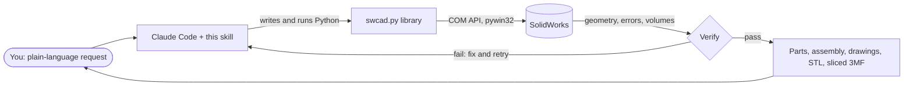

# Claude × SolidWorks

### Describe the part. Claude builds it in SolidWorks, measures it, and proves it works.

[](LICENSE)


[עברית](README.he.md) · [Getting started](docs/getting-started.md) · [How it works](docs/how-it-works.md) · [Changelog](docs/changelog/README.md) · [Example project](examples/desk-agent/README.md)

<p align="center">
  <a href="assets/demo/demo.mp4"></a>
  <br><sub>Claude building a folding phone stand (3 parts + mated assembly) from the Claude tab inside SolidWorks, then changing it in place (thinking time cut, sped up). <a href="assets/demo/demo.mp4">Full video</a></sub>
</p>

<p align="center">
  <a href="https://www.linkedin.com/in/yanir-hazan"></a>
  <a href="https://www.linkedin.com/in/yanir-hazan"></a>
</p>

A **skill for [Claude Code](https://claude.com/claude-code)** that turns Claude into a SolidWorks engineer on your own PC. You say what you need in plain words, Hebrew or English. Claude writes and runs the code, builds real parametric parts and assemblies, **checks every dimension and every fit with numbers, and only then says it's done.** No copying error messages back and forth.

## Why engineers use it

- **Nothing is "done" until it's measured.** Bounding box, volume, mass, interference and a save, close, reopen test with zero errors. A step that can't show its numbers isn't finished.
- **Models a human can keep working on.** Every dimension is a named global in *Tools → Equations*. Change one number and the whole assembly follows. Edit by hand and Claude picks up your change instead of overwriting it.
- **Claude inside SolidWorks.** A chat tab in the Task Pane: select a face or a component, type what you want, watch it happen. No add-in, no C#, no admin rights.
- **Built for real, big assemblies.** Field-tested on a 770-component structure on SolidWorks 2019: a design change plus a full re-check in minutes, not hours ([measurements](skill/solidworks-api/references/assemblies.md)). Each call to SolidWorks takes 0.15 ms instead of ~15 ms, about 100x faster than plain scripting ([details](docs/changelog/2026-11-18-v2.2.md)).
- **From idea to factory floor.** Production drawings with BOM and balloons, PDF / DXF, print-ready STL and sliced Bambu Studio projects.

## What it can do

| | |
|---|---|
| **Parametric parts** | Every dimension linked to a named global, editable by hand. Hole Wizard holes, patterns, mirrors, SolidWorks materials. |
| **Verification** | Size and volume against hand calculations, an edit test, reopen with zero rebuild errors, a one-page review report. |
| **Assemblies** | Skeleton-driven layouts, interference checks with a list of *designed* overlaps, moving parts swept through every position. |
| **Design for change** | Client values live in one place. Update in place in seconds, never rebuild the files. |
| **Engineering checks** | Snap-fit strain, detent torque, tipping stability, tolerance stacks. |
| **Drawings** | Standard views and scale, model dimensions, section views, tolerances, BOM, ISO or company title block. |
| **3D printing** | Print orientation, overhang and support analysis, sliced projects with time and filament per plate. |

## Built with it: the desk agent

<p align="center">
  
</p>

A desk display with a touch screen, a presence radar, a light bar and a speaker, designed from the first sketch to the sliced print files. Test coupons, hidden snap fits, an adjustable kickstand checked at six angles, a production drawing, and an honest list of what went wrong. [See the full project →](examples/desk-agent/README.md)

<p align="center">
  
  
  
</p>

## How it works



SolidWorks' API is huge and full of traps. The skill packages every trap that broke a real build, with its fix, a library that handles them, and a method: ask for missing measurements first, print test coupons before the big part, verify everything. [More →](docs/how-it-works.md)

## Quick start (5 minutes, no code)

**You need:** a Windows PC with SolidWorks (2019 to 2025, Student Edition works) and a Claude account. Everything else is installed for you.

1. Press **Windows key + R**, paste this line, press **Enter**:
   ```
   powershell -ExecutionPolicy Bypass -NoExit -c "irm https://raw.githubusercontent.com/YanirBarHazan/Claude-solidworks-pro/main/install.ps1 | iex"
   ```
   *Or:* **Code → Download ZIP** on this page, extract it, double-click **`install.cmd`**.
   On a work computer, read [Permissions and what it changes on your PC](#permissions-and-what-it-changes-on-your-pc) first: it has a line that installs a fixed, reviewed version.
2. Wait for **Done** (it installs Python and Claude Code if missing, the skill, and the Claude tab).
3. Open SolidWorks. The **Claude** tab appears in the Task Pane on the right. First time only: click **connect to Claude**.
4. Type what you need, for example:
   > *Design a wall bracket for a 40 mm pipe, two M5 screws, printable in PLA without supports.*

   For a new design, Claude first asks a few short start questions (how much to verify, a review report, its understanding of your design). Then it builds. Small changes to an existing model (a value, a fillet, a rename) it just does.

   The tab speaks Hebrew and English: switch with the flag at the top of the tab.

Using Claude Code outside SolidWorks works too: the skill is in `%USERPROFILE%\.claude\skills\solidworks-api`, and on first use Claude checks that the tab is installed and fixes it if not. Step by step with pictures: [docs/getting-started.md](docs/getting-started.md).

## Permissions and what it changes on your PC

Read this before installing on a work computer.

**What Claude may do in the tab without asking.** The Claude tab runs Claude Code in the background with these
permissions, so it does not stop for a click on every step:

- read, write and edit files (`Read`, `Write`, `Edit`, `Glob`, `Grep`) in the save folder you chose and in the
  tab's own working folder;
- run `python` / `py`, plus `ls`, `dir`, `mkdir`, `copy`, `cp` and `tasklist`.

Running Python is the one that matters: Python can do anything your Windows user can do. In practice, **Claude in
the tab can run any code on this PC without asking you first.** That is what lets it build and measure in
SolidWorks on its own. The skill's rules narrow what it does (new files only in the save folder; it shows
Approve / Reject before a rebuild, a delete, or overwriting a file it did not create; it never touches files
outside the project), but those are instructions to the model, not a lock. Use it on a machine and with files
you are comfortable with, and keep important CAD work under backup or version control. The tab loads no MCP
servers and no web tools. Claude Code outside the tab keeps your own permission settings and prompts.

**What the installer changes.** No admin rights, no registry, no SolidWorks add-in, nothing outside your user
profile:

| What | Where |
|---|---|
| Python 3.12, only if missing | winget, user scope |
| Claude Code, only if missing | the official installer, `%USERPROFILE%\.local\bin` |
| `pywin32`, `numpy` | `pip install --user` |
| The skill | `%USERPROFILE%\.claude\skills\solidworks-api` (an older copy moves to `~\.solidworks-api\backups\`) |
| The tab's copy, chats, settings, logs | `%USERPROFILE%\.solidworks-api\` |
| A shortcut that starts the tab at Windows sign-in | Startup folder: `Claude SolidWorks tab.lnk` |

To remove: `python "%USERPROFILE%\.claude\skills\solidworks-api\scripts\install_panel.py" --remove` (stops
the tab and removes the sign-in shortcut), then delete the two folders above.

**Install a fixed version (recommended at work).** The quick-start line always installs the latest `main`. To
install exactly the version you (or your IT) reviewed, pin a release:

```
powershell -ExecutionPolicy Bypass -NoExit -c "$env:SW_INSTALL_REF='v2.4.0'; irm https://raw.githubusercontent.com/YanirBarHazan/Claude-solidworks-pro/v2.4.0/install.ps1 | iex"
```

Or download `install.ps1` from the [releases page](https://github.com/YanirBarHazan/Claude-solidworks-pro/releases),
read it, and run `powershell -ExecutionPolicy Bypass -File install.ps1 -Ref v2.4.0`. `-Ref` takes a release tag,
a branch or a commit.

## Updating

Run the same line (or `install.cmd`) again. It stops the old tab, installs the latest version (the old one goes to `~\.solidworks-api\backups\`, chats and settings are kept) and starts the new tab. Restart SolidWorks if it was open.

## Repository layout

```
skill/solidworks-api/   the skill itself (SKILL.md, scripts, references)
dist/                   the skill packed for upload
docs/                   guides, architecture, troubleshooting, changelog (docs/he: Hebrew)
examples/               real projects: desk agent, large structure, drawings, skeleton grid
assets/                 images and the demo video
```

## Latest updates

- **2026-11-23, v2.4: English tab, clear permissions, pinned install.** A flag in the tab switches Hebrew / English; the README spells out what Claude may do without asking and what the installer changes; `-Ref` installs a reviewed version; small changes skip the start questions. [Details](docs/changelog/2026-11-23-v2.4.md)
- **2026-11-23, v2.3: Install in one line.** The installer sets up Python, Claude Code, the skill and the Claude tab; the tab opens with SolidWorks every time; Claude asks the start questions first. [Details](docs/changelog/2026-11-23-onboarding.md)
- **2026-11-18, v2.2: Claude inside SolidWorks.** A chat tab in the Task Pane, fast mode with COM calls up to 100x faster, and design for change: a span edit plus a full re-check in 5 s. [Details](docs/changelog/2026-11-18-v2.2.md)
- **2026-11-18: Drawings in one call.** Views, model dimensions, sections, BOM and balloons, PDF / DXF, a light start check and a one-page review report. [Details](docs/changelog/2026-11-18-drawings.md)

[Full changelog →](docs/changelog/README.md)

## License

[MIT](LICENSE). SolidWorks is a trademark of Dassault Systèmes. This project is not affiliated with Dassault Systèmes or Anthropic.

## Feedback and custom versions

Ideas, bugs, a story of what you built, or a company that wants this tuned to its own standards: **[Yanir Bar Hazan on LinkedIn](https://www.linkedin.com/in/yanir-hazan)**.
