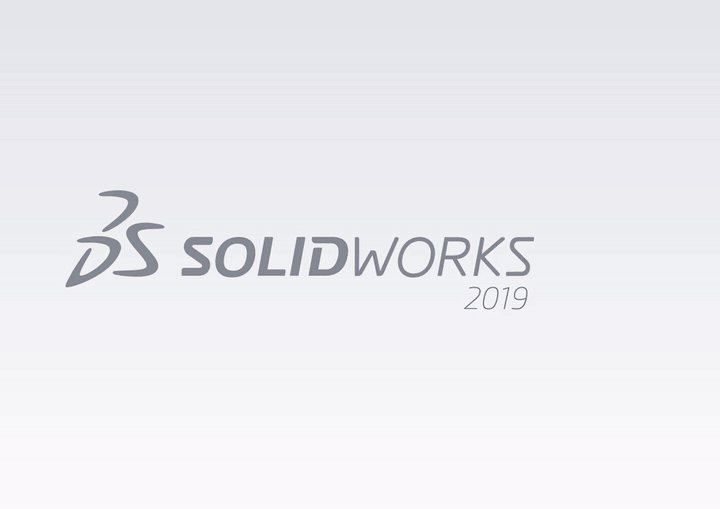
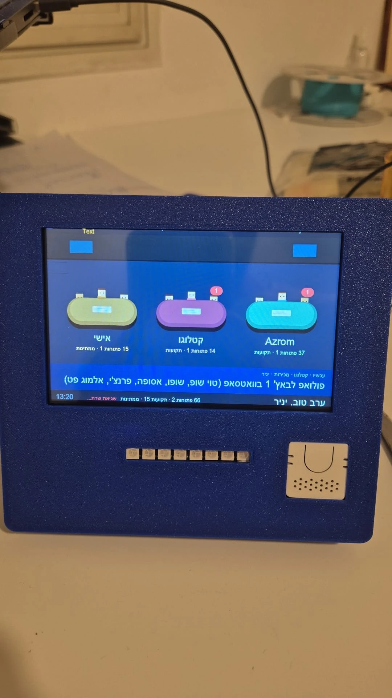
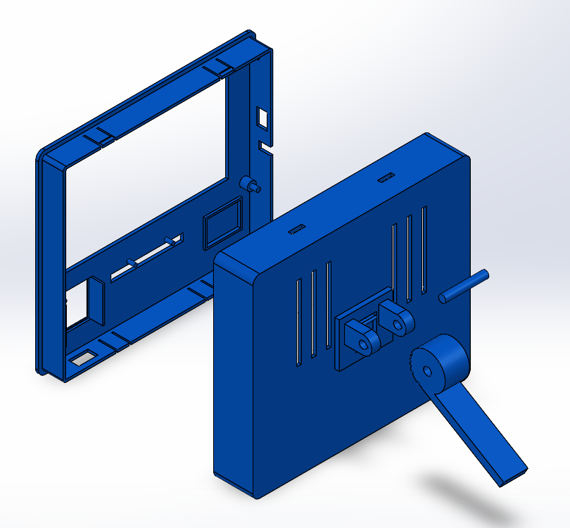
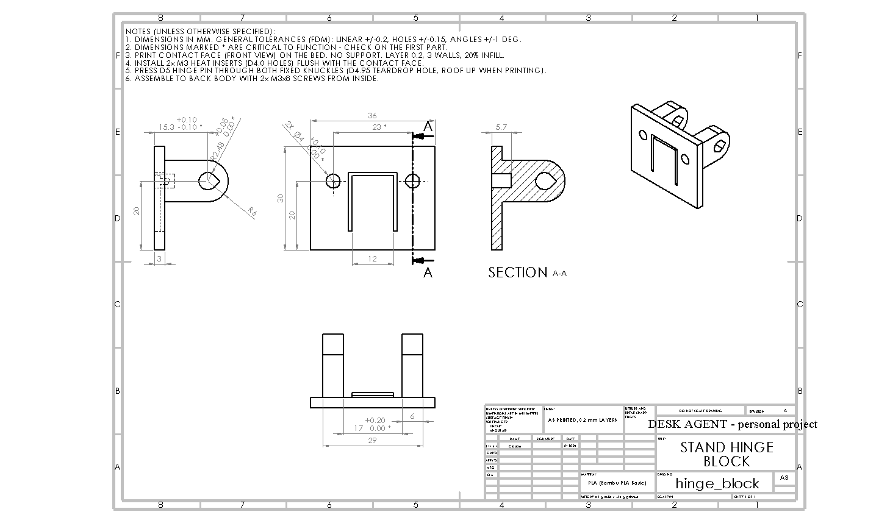
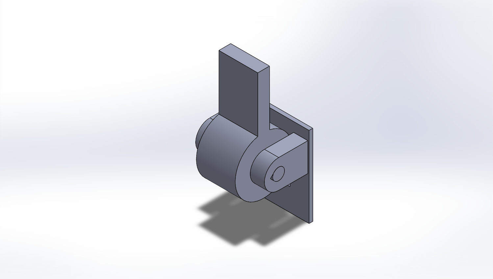

# Claude × SolidWorks

### Describe the part. Claude builds it in SolidWorks, measures it, and proves it works.

[](LICENSE)


[עברית](README.he.md) · [Getting started](docs/getting-started.md) · [How it works](docs/how-it-works.md) · [Changelog](docs/changelog/README.md) · [Example project](examples/desk-agent/README.md)

<p align="center">
  <a href="assets/demo/demo.mp4"></a>
  <br><sub>Claude building a folding phone stand (3 parts + mated assembly) from the Claude tab inside SolidWorks, then changing it in place (thinking time cut, sped up). <a href="assets/demo/demo.mp4">Full video</a></sub>
</p>

A **skill for [Claude Code](https://claude.com/claude-code)** that turns Claude into a SolidWorks engineer on your own PC. You say what you need in plain words, Hebrew or English. Claude writes and runs the code, builds real parametric parts and assemblies, **checks every dimension and every fit with numbers, and only then says it's done.** No copying error messages back and forth.

## Why engineers use it

- **Nothing is "done" until it's measured.** Bounding box, volume, mass, interference and a save, close, reopen test with zero errors. A step that can't show its numbers isn't finished.
- **Models a human can keep working on.** Every dimension is a named global in *Tools → Equations*. Change one number and the whole assembly follows. Edit by hand and Claude picks up your change instead of overwriting it.
- **Claude inside SolidWorks.** A chat tab in the Task Pane: select a face or a component, type what you want, watch it happen. No add-in, no C#, no admin rights.
- **Built for real, big assemblies.** Tested on assemblies of more than 2,000 components on SolidWorks 2019: a design change plus a full re-check in minutes, not hours. COM calls up to 100x faster than plain scripting.
- **From idea to factory floor.** Production drawings with BOM and balloons, PDF / DXF, print-ready STL and sliced Bambu Studio projects.

## What it can do

| | |
|---|---|
| **Parametric parts** | Every dimension linked to a named global, editable by hand. Hole Wizard holes, patterns, mirrors, SolidWorks materials. |
| **Verification** | Size and volume against hand calculations, an edit test, reopen with zero rebuild errors, a one-page review report. |
| **Assemblies** | Skeleton-driven layouts, interference checks with a list of *designed* overlaps, moving parts swept through every position. |
| **Design for change** | Client values live in one place. Update in place in seconds, never rebuild the files. |
| **Engineering checks** | Snap-fit strain, detent torque, tipping stability, tolerance stacks. |
| **Drawings** | Standard views and scale, model dimensions, section views, tolerances, BOM, ISO or company title block. |
| **3D printing** | Print orientation, overhang and support analysis, sliced projects with time and filament per plate. |

## Built with it: the desk agent

<p align="center">
  
</p>

A desk display with a touch screen, a presence radar, a light bar and a speaker, designed from the first sketch to the sliced print files. Test coupons, hidden snap fits, an adjustable kickstand checked at six angles, a production drawing, and an honest list of what went wrong. [See the full project →](examples/desk-agent/README.md)

<p align="center">
  
  
  
</p>

## How it works


SolidWorks' API is huge and full of traps. The skill packages every trap that broke a real build, with its fix, a library that handles them, and a method: ask for missing measurements first, print test coupons before the big part, verify everything. [More →](docs/how-it-works.md)

## Quick start

> Step-by-step guide for beginners: **[docs/getting-started.md](docs/getting-started.md)**

1. **You need:** Windows, SolidWorks (tested on 2019 and 2025, Student Edition works), [Python 3.10+](https://www.python.org/downloads/) and [Claude Code](https://claude.com/claude-code).
2. Install the Python bridge:
   ```bash
   python -m pip install pywin32 numpy
   ```
3. Install the skill: copy [`skill/solidworks-api`](skill/solidworks-api) to `%USERPROFILE%\.claude\skills\`. Or, in the Claude desktop app, upload [`dist/solidworks-api.skill`](dist/solidworks-api.skill).
4. Open SolidWorks normally (not *Run as administrator*) and run the self test:
   ```bash
   python "%USERPROFILE%\.claude\skills\solidworks-api\scripts\smoke_test.py"
   ```
   It should print `SMOKE TEST OK`.
5. Open Claude Code in an empty folder and ask, for example:
   > *Design a wall bracket in SolidWorks for a 40 mm pipe, two M5 screws, printable in PLA without supports.*

## Updating

The Claude tab keeps running the version it started with, so replacing files alone leaves the old tab in SolidWorks. Close SolidWorks, then in PowerShell:

```powershell
irm https://raw.githubusercontent.com/YanirBarHazan/Claude-solidworks-pro/main/update.ps1 -OutFile $env:TEMP\swupd.ps1
powershell -ExecutionPolicy Bypass -File $env:TEMP\swupd.ps1
```

It stops the old tab and worker, replaces `%USERPROFILE%\.claude\skills\solidworks-api` with the latest version (the old one goes to `~\.solidworks-api\backups\`; chats and settings are kept) and restarts the tab watcher. Open SolidWorks again and restart Claude Code. If you uploaded the skill in the Claude desktop app, also upload the new [`dist/solidworks-api.skill`](dist/solidworks-api.skill) there.

## Repository layout

```
skill/solidworks-api/   the skill itself (SKILL.md, scripts, references)
dist/                   the skill packed for upload
docs/                   guides, architecture, troubleshooting, changelog (docs/he: Hebrew)
examples/               real projects: desk agent, large structure, drawings, skeleton grid
assets/                 images and the demo video
```

## Latest updates

- **2026-11-18, v2.2: Claude inside SolidWorks.** A chat tab in the Task Pane, fast mode with COM calls up to 100x faster, and design for change: a span edit plus a full re-check in 5 s. [Details](docs/changelog/2026-11-18-v2.2.md)
- **2026-11-18: Drawings in one call.** Views, model dimensions, sections, BOM and balloons, PDF / DXF, a light start check and a one-page review report. [Details](docs/changelog/2026-11-18-drawings.md)

[Full changelog →](docs/changelog/README.md)

## License

[MIT](LICENSE). SolidWorks is a trademark of Dassault Systèmes. This project is not affiliated with Dassault Systèmes or Anthropic.
