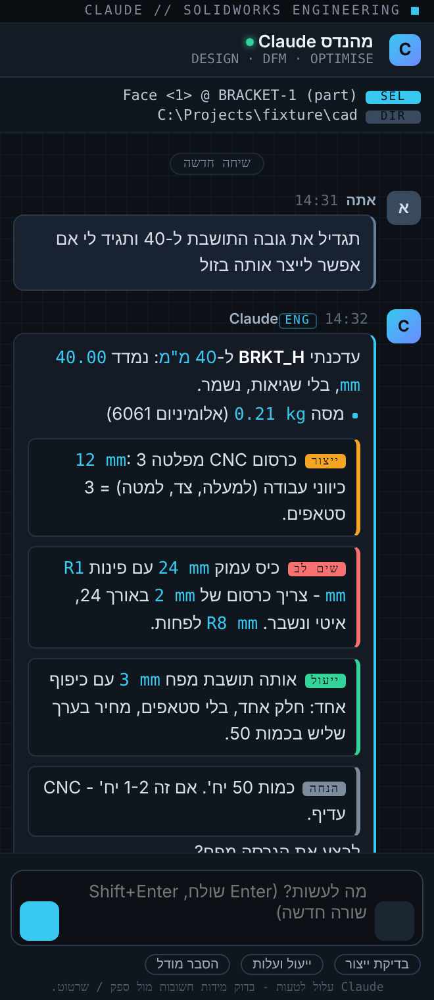

# What's new (2026-11-20): the Claude tab as a manufacturing engineer

- **New look**: dark engineering theme with a telemetry strip (selection / save folder), numbers with units
  highlighted, a scanning "working" bar and quick-prompt chips (manufacturing check, cost and optimisation,
  explain the model). Written for the IE11 engine that hosts the Task Pane.
- **Insight cards**: after the result, Claude adds up to 4 short, model-specific lines tagged `[למה]` (why),
  `[ייצור]` (how it will be made), `[ייעול]` (an improvement with its gain in numbers), `[שים לב]` (a risk) and
  `[הנחה]` (an assumption); the tab shows each as a coloured card. Every remark rests on a measured feature.
- **Manufacturing knowledge**: [`references/manufacturing.md`](../../skill/solidworks-api/references/manufacturing.md) -
  process choice by quantity, rules of thumb for milling, turning, sheet metal, welding, moulding and printing,
  and an optimisation checklist (fewer parts, standard parts, fewer setups, right process, material, tolerances).

[All updates](README.md) · [Back to the main page](../../README.md)
