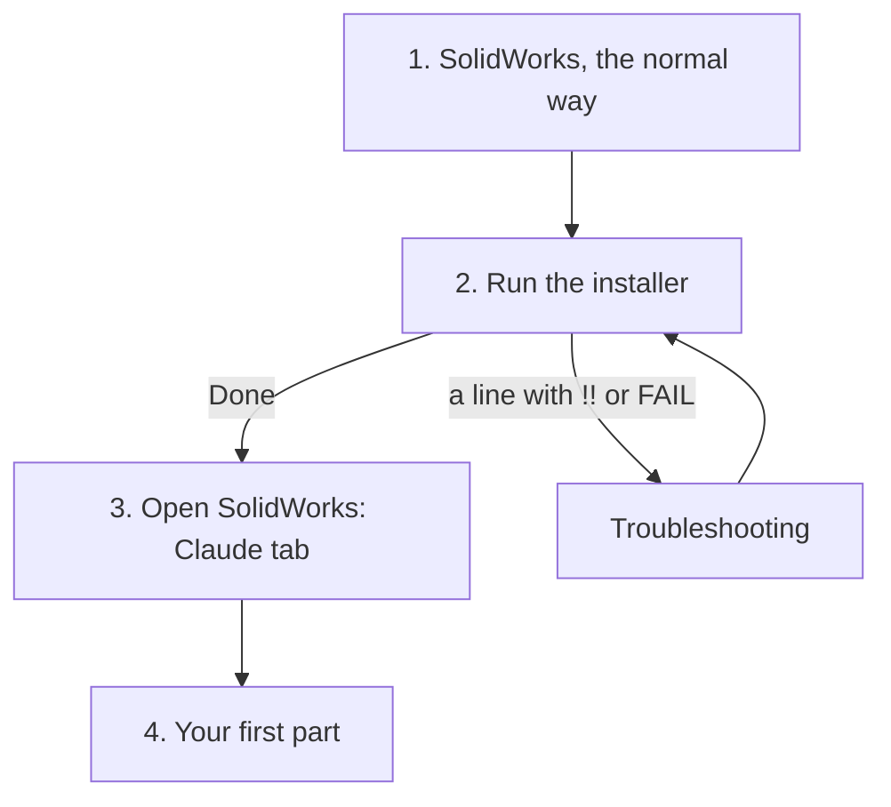
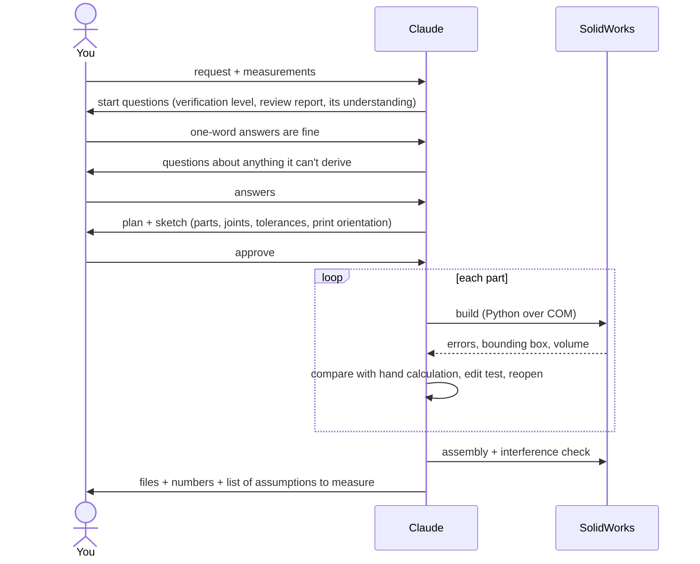

# Getting started: from zero to your first part

No code, about 5 minutes. You need a Windows PC with SolidWorks and a Claude account; the installer adds everything else.



## 1. SolidWorks

- Any SolidWorks from 2019 to 2025 on Windows, Student Edition included.
- Start it **the normal way** from the Start menu, never *Run as administrator*: an elevated SolidWorks is invisible to other programs.
- Close it before installing (or reopen it afterwards).

## 2. Run the installer

Press **Windows key + R**, paste this line, press **Enter**:

```
powershell -ExecutionPolicy Bypass -NoExit -c "irm https://raw.githubusercontent.com/YanirBarHazan/Claude-solidworks-pro/main/install.ps1 | iex"
```

Or: on the GitHub page **Code → Download ZIP**, extract it, double-click **`install.cmd`**.

A blue window prints one line per step:

| Line | What it did |
|---|---|
| `[OK] Python` | found Python, or installed Python 3.12 with winget |
| `[OK] Claude Code` | found the Claude app's Claude Code, or installed Claude Code |
| `[OK] skill 2.x -> ...` | installed the skill in `%USERPROFILE%\.claude\skills\solidworks-api` |
| `OK pywin32`, `OK tab watcher running` | the Claude tab: starts now and at every Windows sign-in |
| `Done.` | ready |

Windows may show *"Windows protected your PC"* for `install.cmd`: click **More info → Run anyway**.

## 3. Open SolidWorks

The **Claude** tab appears in the Task Pane on the right, about 10 seconds after SolidWorks opens.
First time only: click **connect to Claude** in the tab; a browser opens, approve, and the tab notices by itself.

Optional self test (one minute, builds and checks a small part), with SolidWorks open:

```bash
python "%USERPROFILE%\.claude\skills\solidworks-api\scripts\smoke_test.py"
```

It should end with `SMOKE TEST OK`. Anything else: [troubleshooting](troubleshooting.md).

## 4. Your first part

1. Easiest: type in the Claude tab inside SolidWorks. (Or open Claude Code in an empty project folder, for example `Documents\bracket`.)
2. Ask in plain words, with the measurements you know:

   > *Design a wall bracket in SolidWorks for a 40 mm pipe. Two M5 countersunk screws 60 mm apart. 3D printed in PLA on a Bambu A1, no supports.*

What happens next:



The parts are saved in `parts\` inside your project folder, as normal `.sldprt` files. Open them in SolidWorks like any other part.

## Good habits that save time and credits

- **Give measurements up front**, and say which ones you measured and which you're guessing.
- **For boards and modules, send a photo from the side you'll look at.** Directions described from the back mirror the whole design.
- **List every cable and connector you'll actually plug in.** Each one gets space reserved in the model.
- **Print the test coupons** the skill suggests (snap, hinge, press fit) before the big part. Twenty minutes of printing saves hours.
- **Small changes:** ask Claude to *update* the part, not to rebuild it. Value-only changes take seconds. See [Workflow → Changing a part](workflow.md#changing-a-part).
- **Editing by hand is fine.** The scripts detect your edits and ask before touching the part. See [How it works → Hand edits](how-it-works.md#hand-edits).

Next: [How it works](how-it-works.md) · [Workflow](workflow.md)

## Updating

Run the same line (or `install.cmd`) again. Restart SolidWorks if it was open.

## Feedback

How did it go? Ideas, problems, or a custom version for your company: **[Yanir Bar Hazan on LinkedIn](https://www.linkedin.com/in/yanir-hazan)**.
