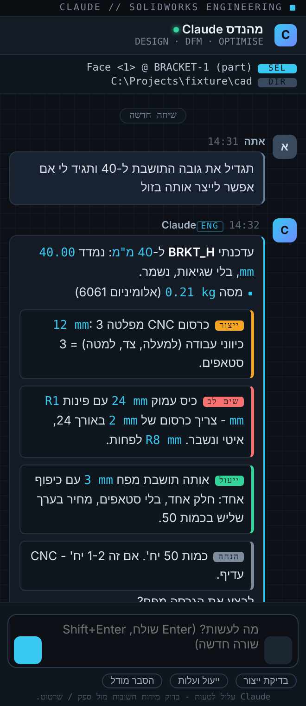

# מה חדש (20/11/2026): הטאב של Claude כמהנדס ייצור

- **מראה חדש**: עיצוב הנדסי כהה עם פס נתונים (בחירה / תיקיית שמירה), מספרים עם יחידות מודגשים, פס "עובד"
  סורק, וכפתורי קיצור: בדיקת ייצור, ייעול ועלות, הסבר מודל.
- **כרטיסי תובנה**: אחרי התוצאה Claude מוסיף עד 4 שורות קצרות על המודל הספציפי - `[למה]`, `[ייצור]`,
  `[ייעול]` (שיפור עם רווח במספרים), `[שים לב]` (סיכון), `[הנחה]` - וכל אחת מוצגת ככרטיס צבעוני. כל הערה
  נשענת על מידה שנמדדה במודל.
- **ידע ייצור**: [`references/manufacturing.md`](../../../skill/solidworks-api/references/manufacturing.md) - בחירת
  שיטה לפי כמות, כללי אצבע לכרסום, חריטה, פח, ריתוך, הזרקה והדפסה, ורשימת ייעול (פחות חלקים, חלקים
  סטנדרטיים, פחות סטאפים, שיטה נכונה, חומר, טולרנסים).

[כל העדכונים](README.md) · [לעמוד הראשי](../../../README.he.md)

