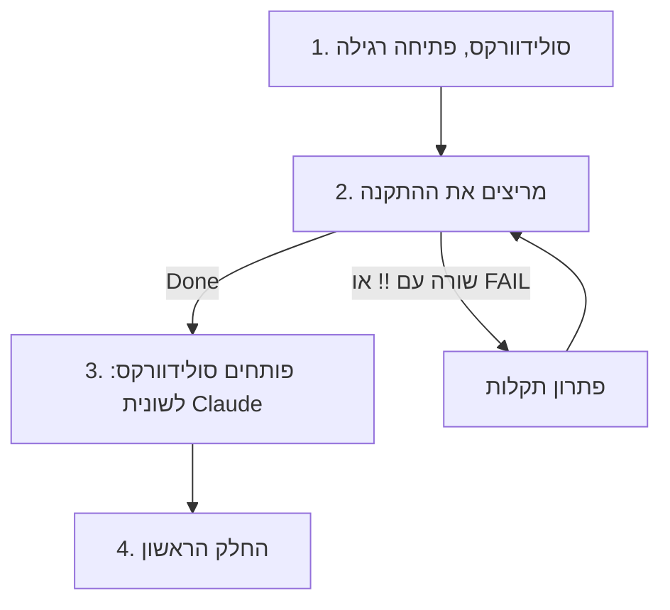

<div dir="rtl">

# מדריך למתחילים: מאפס לחלק הראשון

בלי קוד, בערך 5 דקות. צריך מחשב Windows עם סולידוורקס וחשבון Claude. את כל השאר ההתקנה מוסיפה לבד.

</div>



<div dir="rtl">

## 1. סולידוורקס

- כל גרסה מ-2019 עד 2025 ל-Windows, כולל גרסת הסטודנט.
- **פותחים בצורה רגילה** מתפריט ההתחלה, ולא "הפעל כמנהל". סולידוורקס שרץ כמנהל לא נראה לתוכנות אחרות.
- סוגרים אותו לפני ההתקנה (או פותחים אותו מחדש אחריה).

## 2. מריצים את ההתקנה

לוחצים **מקש Windows + R**, מדביקים את השורה הזאת ולוחצים **Enter**:

</div>

```
powershell -ExecutionPolicy Bypass -NoExit -c "irm https://raw.githubusercontent.com/YanirBarHazan/Claude-solidworks-pro/main/install.ps1 | iex"
```

<div dir="rtl">

או: בעמוד ה-GitHub לוחצים **Code ← Download ZIP**, מחלצים, ולוחצים פעמיים על **`install.cmd`**.

נפתח חלון כחול שמדפיס שורה לכל שלב:

- `[OK] Python`: פייתון נמצא, או הותקן לבד דרך winget.
- `[OK] Claude Code`: נמצא Claude Code של אפליקציית Claude, או שהותקן.
- `[OK] skill 2.x`: המיומנות הותקנה ב-`%USERPROFILE%\.claude\skills\solidworks-api`.
- `OK pywin32`, `OK tab watcher running`: לשונית Claude פועלת עכשיו, ותעלה לבד בכל כניסה ל-Windows.
- `Done.`: מוכן.

אם Windows מציג "Windows protected your PC" עבור `install.cmd`, לוחצים **More info** ואז **Run anyway**.

## 3. פותחים את סולידוורקס

הלשונית **Claude** מופיעה בחלונית המשימות מימין, כ-10 שניות אחרי שסולידוורקס נפתח.
בפעם הראשונה בלבד לוחצים בלשונית **התחבר ל-Claude**. נפתח דפדפן, מאשרים, והלשונית מזהה לבד שסיימת.

בדיקה עצמית (לא חובה, דקה אחת, בונה ובודקת חלק קטן), כשסולידוורקס פתוח:

</div>

```bash
python "%USERPROFILE%\.claude\skills\solidworks-api\scripts\smoke_test.py"
```

<div dir="rtl">

בסוף צריך להופיע `SMOKE TEST OK`. אם מופיע משהו אחר: [פתרון תקלות](../troubleshooting.md).

## 4. החלק הראשון

1. הכי פשוט: כותבים בלשונית Claude שבתוך סולידוורקס. (אפשר גם לפתוח Claude Code בתיקייה ריקה לפרויקט, למשל `Documents\bracket`.)
2. מבקשים במילים פשוטות, עם המידות שידועות לך:
   > *תתכנן תושבת לקיר לצינור 40 מ"מ, שני ברגי M5 שקועים במרחק 60 מ"מ, להדפסה ב-PLA על Bambu A1 בלי תמיכות.*

**מה קורה אחר כך:**
1. קלוד שואל קודם את שאלות הפתיחה: כמה לבדוק, האם להוציא דוח סקירה, ומה הוא הבין. תשובה של מילה אחת מספיקה.
1. אחר כך הוא שואל על כל מה שהוא לא יכול לחשב לבד.
2. הוא מציג תוכנית עם סקיצה, ומחכה לאישור שלך.
3. הוא בונה כל חלק ובודק אותו.
4. הוא בודק את ההרכבה.
5. הוא מוסר לך את הקבצים, את המספרים, ואת רשימת ההנחות שעוד צריך למדוד.

החלקים נשמרים בתיקייה `parts` בתוך הפרויקט, כקבצי `.sldprt` רגילים.

## הרגלים שחוסכים זמן וקרדיטים

- **נותנים מידות מההתחלה,** ואומרים מה מדדת ומה הערכה.
- **לוחות ומודולים: שולחים תמונה מהצד שממנו מסתכלים עליהם.** כיוונים שמתוארים מהגב הופכים את כל התכנון.
- **מפרטים כל כבל ומחבר שבאמת יתחברו.** לכל אחד נשמר מקום במודל.
- **מדפיסים את חלקי הניסיון** שהמיומנות מציעה לפני החלק הגדול. עשרים דקות הדפסה חוסכות שעות.
- **שינוי קטן:** מבקשים "לעדכן את החלק, לא לבנות מחדש". שינוי של ערך לוקח שניות.
- **מותר לערוך ביד.** הסקריפטים מזהים את השינויים ושואלים לפני שהם נוגעים בחלק.

## עדכון

מריצים שוב את אותה שורה (או את `install.cmd`). אם סולידוורקס היה פתוח, פותחים אותו מחדש.

## משוב

איך היה? רעיונות, תקלות, או גרסה מותאמת לחברה שלך: **[יניר בר חזן בלינקדאין](https://www.linkedin.com/in/yanir-hazan)**.

</div>
